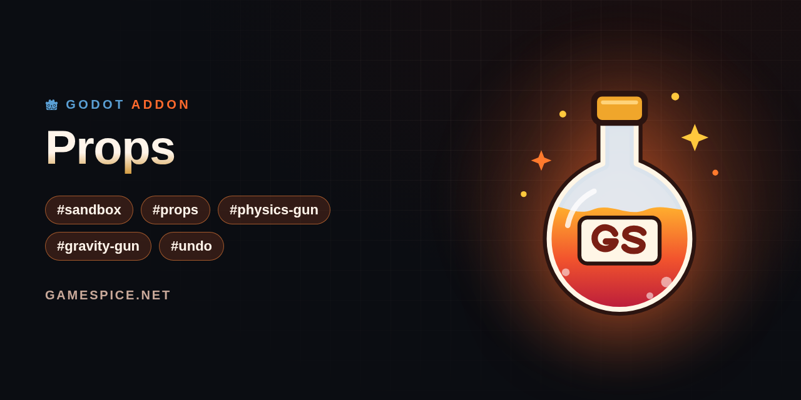

[](https://moddingcommunity.com/a/16-gs-props)

A sandbox for Godot games: players spawn props (crates, furniture, anything with a physics body), move them with a physics gun and a gravity gun, break them, ride on them and wire them together. Props come from a catalogue the operator can edit as JSON.

The server owns every prop and clients only draw what it sends, because physics does not come out identical on two machines. Limits keep a sandbox server alive: per-player budget, spawn delay, frozen-prop limit, undo list, a server-wide limit, and clean-up when a player leaves.

## Install

1. Get [Godot 4.7](https://godotengine.org/download).
2. Either use [GameSpice Bootstrap](https://github.com/gamespice-platform/bootstrap), which clones every project and links the addons, or copy `addons/gs_props/` and [GameSpice Core](https://github.com/gamespice-platform/core)'s `addons/gs_core/` into your project and enable gs-props in *Project > Project Settings > Plugins*.

GameSpice Core is the only dependency.

## Spawning props

```gdscript
var spawner := GSPropSpawner.new()
spawner.authoritative = true                  # server only; otherwise every spawn is refused
spawner.catalogue = GSPropCatalogue.load_json("res://props.json").value
spawner.limits = GSPropLimits.new()
spawner.world_ref = GSNodeRef.of_path(^"../World")   # where props are added
add_child(spawner)

spawner.refused.connect(func(player, prop, reason): tell(player, reason))

spawner.advance(delta)                                 # every tick, in seconds
spawner.spawn(&"crate", player_id, aim_point, Basis.IDENTITY)
spawner.undo(player_id)
spawner.player_left(player_id)                         # removes their props
```

To show a player's subscribed Workshop props in solo, call `spawner.catalogue.follow_content(GSContentIndex.shared())` and rebuild the menu on `content_changed`. See [docs/spawning.md](docs/spawning.md#workshop-props-follow_content).

`props.json`:

```json
{
  "format": 1,
  "props": [
    {"id": "crate", "name": "Crate", "category": "props", "scene": "res://props/crate.tscn", "mass": 20, "max_health": 50},
    {"id": "safe", "name": "Safe", "category": "props", "scene": "res://props/safe.tscn", "mass": 900, "cost": 8},
    {"id": "pillar", "category": "scenery", "scene": "res://props/pillar.tscn", "can_grab": false}
  ]
}
```

A prop's scene is a `RigidBody3D` with no script. Optional fields:

| Field | Meaning |
| --- | --- |
| `size` | Size class. Larger than the server's `max_size` is refused. |
| `limit_group` | Counted against `group_limits`. |
| `can_freeze`, `can_grab`, `rideable` | What players may do with it. |
| `break_impact_speed`, `max_health` | Breaking. `max_health` 0 (default) means unbreakable. |
| `material` | Used for break effects. |
| `explode_radius`, `explode_damage`, `explode_force` | Explosion when it breaks. |
| `entitlement`, `permission` | Who may spawn it. |
| `meta` | Your own data. |

## Settings

Limits live in a `GSPropLimits` resource, layered like every GameSpice config: inspector defaults, then a JSON file, then environment, then command line.

```gdscript
var limits := GSPropLimits.new()
limits.load_layered("user://props.json")
spawner.limits = limits
```

Example: `GS_PROPS_PER_PLAYER_BUDGET=100 <your server> --props-world-budget=2048`.

| Setting | Default | Meaning |
| --- | --- | --- |
| `per_player_budget` | 64 | Props one player may have, counted by `cost`. 0 = unlimited. |
| `spawn_interval` | 0.15 | Seconds between one player's spawns. |
| `per_player_frozen` | 128 | Props one player may freeze. 0 = unlimited. |
| `max_size` | `HUGE` | Largest size class that may be spawned. |
| `group_limits` | none | Per-player counts by `limit_group`, such as `{"vehicles": 4}`. |
| `world_budget` | 1024 | Props on the server from everybody. 0 = unlimited. |
| `clean_up_on_leave` | true | Remove a player's props when they leave. |
| `undo_depth` | 64 | Spawns a player can undo. 0 = no undo, -1 = unlimited. |
| `grab_range` | 40 | Physics gun reach in metres. |
| `grab_mass_limit` | 0 | Heaviest prop it can hold, in kg. 0 = any. |
| `hold_distance_min` / `hold_distance_max` | 1.5 / 25 | How near and far a held prop can be. |

All numbers are defaults you can change.

## Tools

```gdscript
var gun := GSPhysGun.new()
gun.spawner = spawner
gun.wielder = player_id

gun.grab(space_state, eye_position, aim_direction, view_basis)   # on the grab button
gun.hold(eye_position, aim_direction, view_basis, delta)         # every tick while held
gun.push(scroll_amount, delta)                                   # nearer or further
gun.rotate_held(yaw_degrees, pitch_degrees)
gun.release()
gun.freeze_held()

var grav := GSGravGun.new()
grav.spawner = spawner
grav.wielder = player_id

grav.pull(space_state, eye_position, aim_direction)
grav.carry(eye_position, aim_direction, delta)                   # every tick while carrying
grav.punt(space_state, eye_position, aim_direction)
grav.drop()
```

Anybody can move anybody's props by default. `set_protected(player_id, true)` stops other players touching that player's props. Nobody can grab a prop someone else is holding. See [docs/tools.md](docs/tools.md).

## Breakable props

```gdscript
var damage := GSPropDamage.new()
damage.spawner_ref = GSNodeRef.of_path(^"../Props")
damage.authoritative = true                   # server only; otherwise hurt() refuses
add_child(damage)

damage.hurt(prop.instance_id, 25.0, attacker_id)
damage.impact(prop.instance_id, closing_speed, driver_id)   # from a collision
damage.broken.connect(func(prop, at, by): play_break_effect(at))
```

When a prop with an explosion breaks, nearby props are pushed and `exploded` fires with the radius, damage and force. Hurting players is up to your game.

## Standing on props

`GSPropCarry` lets players stand on props. Call `ride()` once per tick for each grounded player: it applies their weight to the prop and returns how far the prop moved them. `push()` shoves a prop a player walks into. See [docs/damage-and-carry.md](docs/damage-and-carry.md).

## Collision shaped like the model

A prop in a map collides as a box unless given pieces. `GSPropPieces.measure(model, frame)` cuts a model into convex hulls. It is slow, so run it in a tool and ship the result. Details: [docs/pieces.md](docs/pieces.md).

```gdscript
# In your measuring tool (editor build):
var pieces := GSPropPieces.measure(model_scene.instantiate(), Transform3D(Basis.from_scale(Vector3.ONE * scale), offset))
file[prop_id] = GSPropPieces.encode(pieces)   # empty when the box is as good

# At run time, on the server and every client:
for shape in GSPropPieces.shapes(GSPropPieces.decode(file[prop_id])):
    var node := CollisionShape3D.new()
    node.shape = shape
    body.add_child(node)
```

## Wiring props together

A prop lists what it can send and receive in `meta`, for example `{"outputs": ["pressed"]}` on a button and `{"inputs": ["open", "close"]}` on a door.

```gdscript
var io := GSPropIO.new()
io.spawner_ref = GSNodeRef.of_path(^"../Props")
add_child(io)

io.link(button.instance_id, &"pressed", door.instance_id, &"open")
io.fire(button.instance_id, &"pressed")
io.input_received.connect(func(target, input, value, source): open_door(target))
```

What "open" means is up to your game.

## Hiding as a prop

For hide-and-seek games, `GSPropDisguise` holds what a player is disguised as and works out the collision capsule, health and hitbox from the prop's size, identically on the server and clients. `GSPropTaunts` keeps the taunt list, cooldown, points, and a meter that forces a taunt on someone who stood still too long. See [docs/hunt.md](docs/hunt.md).

```gdscript
var rules := GSPropDisguiseRules.new()        # fill from your config
var ok := GSPropDisguise.may_take(size, rules)
var hull := GSPropDisguise.hull(size, rules)  # Vector2(radius, height)
var hp := GSPropDisguise.health(size, rules)

var taunts := GSPropTaunts.new()
taunts.add_all(config_taunts)                  # [{"id", "title", "seconds", "sound"}]
taunts.observe(player_key, position, now)      # every tick
if taunts.due(player_key, now):
    play(taunts.taunt(player_key, now, &"", true, tick))
```

## Toys

Map objects players play with, placed from the map's data: beach ball, football, bowling ball and pins, barrel, tyre, punching bag, swing, see-saw, roundabout, wobbly platform, trampoline, bounce pad, switch, lamp post, fountain, horn and bell. The server simulates them and clients draw what it sends.

```gdscript
var toys := GSPropBodyBox.new()
toys.authoritative = is_server
toys.draw = not is_dedicated_server
toys.loose_layer = layout.layer_mask(&"toy")      # balls, barrels: pushed by walking into them
toys.loose_mask = layout.collision_mask(&"toy")
toys.solid_layer = layout.layer_mask(&"prop")     # see-saws, frames: people stand on them
toys.solid_mask = layout.collision_mask(&"prop")
add_child(toys)
toys.build(map["toys"])          # [{"toy": "beach_ball", "at": [x, y, z], "yaw": 0}, ...]

# Server, every tick, per player:
toys.push_from(feet, velocity, radius, height)
toys.stand_on(feet, 70.0)
toys.advance(delta)
# When a player presses use:
var index := toys.aimed(eye, aim)
if index >= 0:
    toys.use(index, eye, aim)
# In movement code: trampolines and pads throw the player; roundabouts carry them.
var thrown := toys.launch_for(feet, velocity)                 # {velocity, index} or {}
var carried := toys.carry_for(feet, delta, state.ground_id)   # {offset, yaw, index} or {}
# On a shot or explosion:
toys.shot(collider, point, direction, damage)
toys.shot_along(origin, direction, reach, damage, level_mask)
toys.blast(at, radius, speed)
```

Replicate each toy by its index with `state_transform()`, `on` and `count`, and call `show_state` on clients. Connect `sound` to your audio and add `GSPropBodySounds.rows()` to your sound catalogue. Add or retune toys with `GSPropBodyCatalogue.merge_json`. See [docs/toys.md](docs/toys.md).

| Server setting | Meaning |
| --- | --- |
| `sv_physprops` | 0 removes toys. |
| `sv_physprops_awake` | How many simulate at once (default 24, or 8 in a browser). |
| `sv_physprops_push` | How hard walking into one pushes it. |

The old `sv_toys*` names still work as aliases.

## Used by

Every game except Look At Me vendors it:

- [Fatal Contact](https://zeesgames.com/fatal-contact)
- [Airdrift](https://zeesgames.com/airdrift)
- [Playlot](https://zeesgames.com/playlot) - the prop spawner and physics gun
- [Hungario](https://zeesgames.com/hungario)
- [Buses From Hell](https://zeesgames.com/buses-from-hell)
- [Smash Copter](https://zeesgames.com/smash-copter) - the cannon's falling props
- [Zombie Zone](https://zeesgames.com/zombie-zone)
- [Hide n Seek](https://zeesgames.com/hide-n-seek)
- [Prop Hunt](https://zeesgames.com/prop-hunt) - hiders disguise as props
- [Murder Mystery](https://zeesgames.com/murder-mystery)
- [Deathrun](https://zeesgames.com/deathrun)
- [Wipeout](https://zeesgames.com/wipeout)
- [Dangerous Delivery](https://zeesgames.com/dangerous-delivery)

The whole collection is at [zeesgames.com](https://zeesgames.com).

## Credits

| Asset | Author / source | License |
| --- | --- | --- |
| Toy sounds | [Kenney](https://www.kenney.nl) | CC0 |
| Horn sound | Made for this addon | CC0 |
| Toy models (pin, barrel, crate, tyre, lamp post, fountain, horn, bell) in `addons/gs_props/toys/models/` | Made for this addon with `art-src/build_toy_models.py` (headless Blender) | CC0 |

Every toy has a code-built fallback, so a pack without `models/` still draws. Per-file list of sounds: `addons/gs_props/toys/sounds/CREDITS.md`.

## Testing

Import the project once, then run `examples/props_selftest.tscn` headless with Godot. More docs: [docs/models.md](docs/models.md), [docs/history.md](docs/history.md).

## Status and licence

Part of the [**GameSpice**](https://gamespice.net) platform: a family of Godot addons, MIT licensed and built with Claude Code. The headless scene `props_selftest` covers it (see Testing). Games in [Zee's Games](https://zeesgames.com) are built on GameSpice addons and run on live servers, and props are spawned, carried and broken in them every round. Report bugs on the [issue tracker](https://github.com/gamespice-platform/props/issues).

MIT licence, see [LICENSE](LICENSE). The only closed part of the [**GameSpice**](https://gamespice.net) platform is the web back end; you can use your own instead of GameSpice's.
